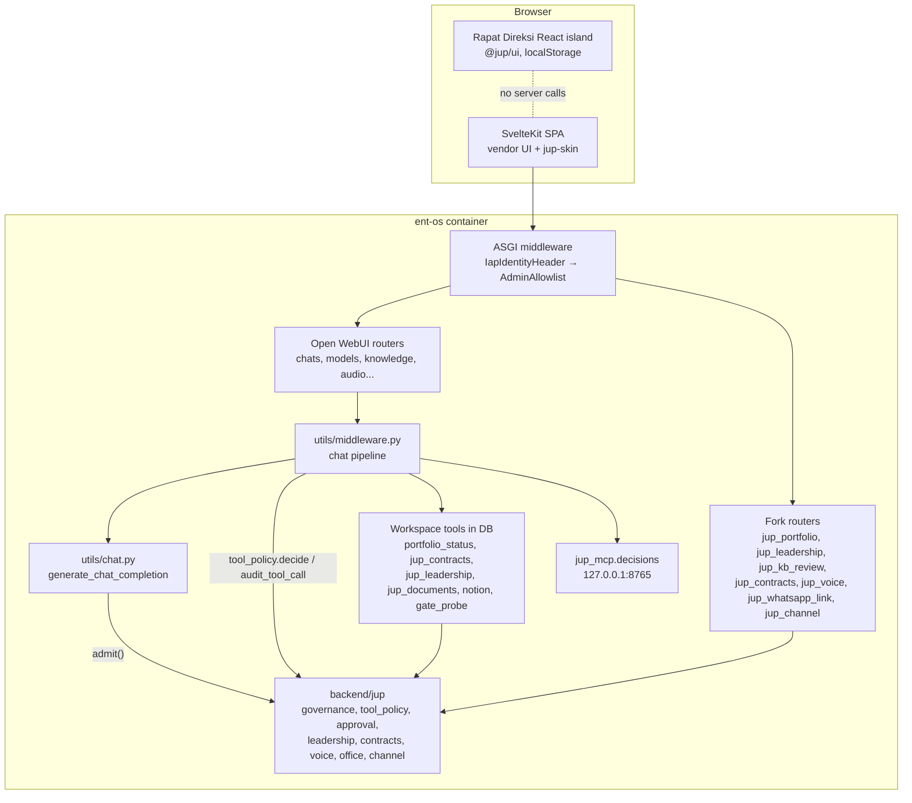
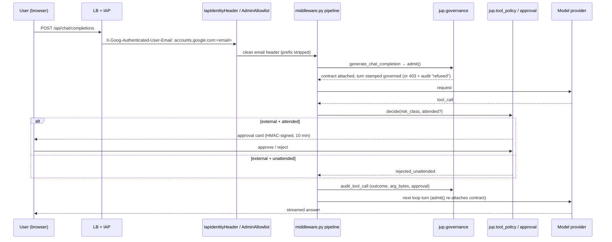
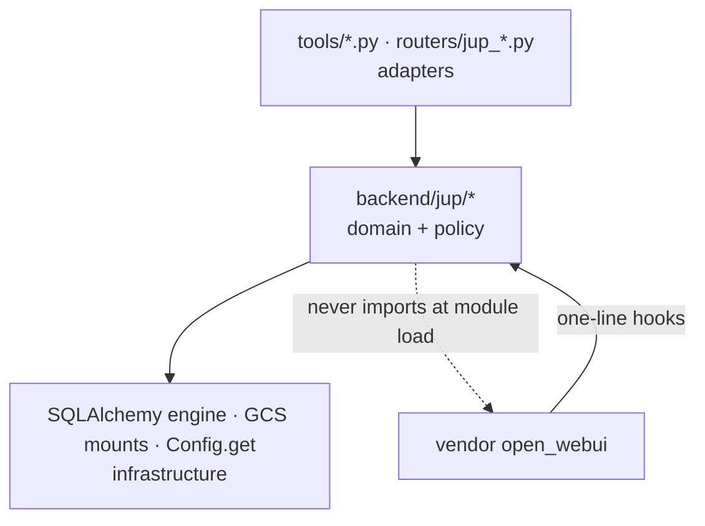

# System Architecture Blueprint — None-JUPe (JUP Operating Layer)

> Generated 2026-10-05 against `origin/main` `1b5efa3f9` (live revision `ent-os-00104-wjt`, image
> `de2b97d59`). This is the **system-level** view of the fork. Files `01`–`16` in this folder describe
> the vendor Open WebUI codebase as of v0.11.3 and stay authoritative for vendor internals; the
> decisions themselves live in `docs/adr/`. Where this document and the code disagree, the code wins
> — fix this document in the same PR.
>
> Detected stack: Python 3.11 / FastAPI / SQLAlchemy + alembic (backend), SvelteKit `adapter-static`
> with a React 18 island (frontend), Bun / TypeScript (channel gateway), Google Cloud Run + IAP +
> Identity Platform + Cloud SQL Postgres 16 (deployment).
>
> Detected pattern: **a governed fork of a modular monolith** — upstream Open WebUI is the
> monolith; the fork adds a separately-owned domain layer (`backend/jup/`) that hooks into the
> vendor at a small, enumerated set of seams, plus one satellite service (the gateway).

## 1. Architectural overview

None-JUPe is the governed AI workspace PT Jakarta Utilitas Propertindo runs internally (the
"Operating Layer", `CONTEXT.md`). It is Open WebUI with four things added:

1. **A fail-closed governance envelope** around every model call and tool call (ADR-0002, ADR-0013).
2. **JUP domain features** — portfolio gates, Ruang Pimpinan (board/RKA/KPI/Rapat Direksi), the
   contracts KB, staff KB contributions, Office document output, voice.
3. **An identity edge** — IAP in front, Entra staff sign-in via Identity Platform, admin from an
   allowlist (ADR-0012, ADR-0016).
4. **Outside channels** — Teams and WhatsApp through a separate gateway that may only act on behalf
   of a mapped user (E7–E9).

### Guiding principles evident in the code

| Principle | Where it shows |
|---|---|
| **Fail-closed.** A control that cannot prove its answer refuses. | `jup.governance.admit()` refuses ungoverned turns; unclassified tools default to `external`; grants count only on an exact boolean `True`; a missing migration disables only its own feature. |
| **Minimal vendor surface.** Fork logic lives in `backend/jup/`; vendor files get one-line hooks. | Every vendor edit is listed in `deploy/gcp/VENDOR-PATCHES.md` with a lost-patch test (ADR-0007). |
| **Rules live in tested modules, not in exec'd code.** | `tools/*.py` are thin wrappers; the rule is in `jup.*` and tested there. Tool docstrings never gate on identity. |
| **The backend re-asserts everything.** | Frontend guards only hide UI; every fork router checks grants and returns 403. |
| **Derived, never stored, state.** | Current Gate is computed from assessments (ADR-0003); KB partner state is generated from records (ADR-0011). |
| **Every decision is audited, including refusals.** | `jup.governance` audit lines for turns, tool calls, voice, contracts, leadership, channels. |
| **Named non-coverage.** | Tools and docs state what they do not prove; PRs state what was not verified. |

### Boundaries and how they are enforced

| Boundary | Enforcement |
|---|---|
| Vendor ↔ fork | Lost-patch source tests (`tests/test_jup_*_presence.py`, `*_registration.py`, `*_seam.py`); fork tests live in `tests/`, outside `backend/`. |
| Internet ↔ app | Global LB + IAP; Cloud Run ingress `internal-and-cloud-load-balancing`, `--no-allow-unauthenticated`. |
| Gateway ↔ app | `IapIdentityHeaderMiddleware` admits the gateway principal only under `/api/jup/channel/`, only for a non-pending user holding `jup.channel.use`. |
| Model ↔ providers | `utils/chat.py` funnel guard + refusal of every raw passthrough route. |
| Tool ↔ outside world | Risk Class gate before execution; `external` needs the asking user's approval. |
| Feature ↔ feature data | Separate alembic graph and version table per feature (ADR-0014). |
| Repo ↔ `~/jup` | Records are synced to GCS and mounted read-only; drift gates compare. |

## 2. Architecture visualization

### 2.1 System context (C4 level 1)

```mermaid
flowchart LR
    staff[JUP staff<br/>Entra accounts]
    erik[Operators / admins<br/>JUP_ADMIN_EMAILS]
    teams[Microsoft Teams]
    wa[WhatsApp / Meta Cloud API]
    subgraph gcp[GCP project jup-ops · asia-southeast2]
        lb[Global LB + IAP<br/>non-jupe.jup.co.id]
        app[ent-os<br/>Cloud Run]
        gw[jup-gateway<br/>Cloud Run]
        db[(Cloud SQL<br/>Postgres 16 + pgvector)]
        gcs[(GCS: records, legal-kb, data)]
        idp[Identity Platform<br/>oidc.entra-jup]
        sm[Secret Manager]
    end
    entra[JUP Entra tenant]
    openai[OpenAI<br/>models, STT, GPT-Live]
    google[Google Chirp3-HD TTS]
    notion[Notion API]
    jup[~/jup repo<br/>records, kb, DECISIONS.md]

    staff --> lb
    erik --> lb
    lb --> idp --> entra
    lb --> app
    teams --> gw
    wa --> gw
    gw -- custom-token ID token --> lb
    app --> db
    app --> gcs
    app --> sm
    app --> openai
    app --> google
    app --> notion
    jup -. sync-records.sh .-> gcs
    jup -. sync-kb.ts .-> app
```

### 2.2 Containers and components (C4 level 2)



### 2.3 Data flow — one governed chat turn



### 2.4 Data flow — a Channel Turn (WhatsApp)

```mermaid
sequenceDiagram
    participant W as Meta webhook
    participant GW as jup-gateway
    participant E as ent-os /api/jup/channel/turn
    W->>GW: POST /api/whatsapp (X-Hub-Signature-256)
    GW->>GW: verify HMAC, own phone_number_id, dedup (in-memory 5000)
    GW->>GW: hash sender with GATEWAY_HMAC_KEY
    GW->>E: Bearer ID token, x-jup-on-behalf-of: whatsapp:<hash>
    E->>E: middleware maps hash → one user, checks jup.channel.use
    E->>E: process lock + pg_advisory_lock per conversation
    E->>E: governed turn; external tools refused (unattended)
    E-->>GW: answer (403 = refusal)
    GW->>W: Cloud API v25.0 reply
```

## 3. Core architectural components

### 3.1 Vendor core (Open WebUI v0.11.3)

Purpose: chat, models, knowledge/RAG, tools, automations, subagents, audio, admin. Read
`05-backend-utils-a-PIPELINE.md` before touching the request path — `utils/middleware.py` is the
product. `access_grants` is the single authorization authority for vendor resources (`02`, `06`).
Upstream is rebased quarterly (ADR-0007); keep it unmodified except at the seams in §3.2.

### 3.2 Vendor seams (where the fork attaches)

| Seam | File | Fork hook |
|---|---|---|
| ASGI edge | `main.py:840-841` | `AdminAllowlistMiddleware`, `IapIdentityHeaderMiddleware` (last added = outermost) |
| Migrations | `main.py:~891` | `run_leadership_migrations`, `run_contract_migrations`, `run_channel_link_migrations` |
| Routers | `main.py:~896-905` | seven `jup_*` routers |
| Model funnel | `utils/chat.py:184` | `jup_governance.admit()` |
| Passthroughs | `routers/openai.py`, `routers/ollama.py` | `refuse_if_ungoverned`, passthrough refusals |
| Tool execution | `utils/middleware.py` (several sites) | `tool_policy.decide`, `audit_tool_call`, voice tool scope, subagent `external` filter, approval card |
| Tool approval | `utils/tool_approval.py` | owner-only approval via `jup.approval`, 10-min server timeout |
| Tool manifest | `utils/tools.py:360` | `risk_class` from frontmatter |
| Audio | `routers/audio.py` | STT admit/audit, Google TTS engine, sealed-answer speech |
| Retrieval | `routers/retrieval.py` | `chat.web_upload` required for URL/web processing |
| Built-in knowledge | `tools/builtin.py` | model-attached collections readable by the model's users |
| Startup | `start.sh` | launches `jup_mcp.decisions` |

Every row has an entry in `deploy/gcp/VENDOR-PATCHES.md` saying what breaks if dropped.

### 3.3 Fork domain layer — `backend/jup/`

| Concern | Modules | Responsibility |
|---|---|---|
| Identity | `iap_identity.py`, `admin_allowlist.py` | Normalise IAP header; admit gateway on behalf of mapped users; admin from allowlist (promote only). |
| Governance | `governance.py` | Operating contract on every model call; refuse ungoverned; JSONL + logger audit. |
| Tool policy | `tool_policy.py`, `approval.py`, `gate_probe.py` | Risk Classes, built-in classification table, signed approvals, gate self-test tool. |
| Portfolio | `portfolio.py`, `portfolio_tool.py`, `kb_sync.py`, `decisions.py` | Project `~/jup` records into gates/engagements; generate and check KB claims; parse the D-register. |
| Ruang Pimpinan | `leadership/` (policy, reader, actions, evidence, closure, snapshots, imports, kpi, repository, tool) | Default-deny board/RKA reads; append-only action register with BOD closure. |
| Contracts KB | `contracts/` (titles, access, cards, imports, repository, review, tool) | Title-group grants, masking/withholding, card import from legal-kb bucket. |
| Staff KB | `kb_review.py` | Submission/review queue into "JUP Staff Contributions" (ADR-0015). |
| Office output | `office_doc.py`, `office_sheet.py`, `office_slides.py`, `office_tool.py`, `office_floor.py` | docx/xlsx/pptx on JUP templates; classification floor per chat. |
| Voice | `voice.py`, `voice_turn.py`, `voice_audio.py`, `voice_live.py` | Chained pipeline (ADR-0017) and GPT-Live opt-in (ADR-0018). |
| Channels | `channel.py`, `turn.py`, `conversation_lock.py`, `channel_links/` | Channel Turns, Link Codes, two-layer conversation lock. |
| Integrations | `notion.py`, `backend/jup_mcp/decisions.py` | Admin-only read-only Notion; decisions MCP server. |
| Migration introspection | `migrations.py` | Read alembic graphs without importing the runtime (for `test_boot`). |

Fork HTTP surfaces live as `backend/open_webui/routers/jup_*.py` so they mount like vendor routers,
but each router delegates to `jup.*` and carries no rules of its own beyond request parsing.

### 3.4 Workspace tools — `tools/`

Thin `class Tools` wrappers stored in the app DB by `deploy/gcp/sync-tools.ts`. Each declares
`risk_class` in frontmatter.

| Tool | Risk Class | Rule lives in |
|---|---|---|
| `portfolio_status` | read | `jup.portfolio_tool` (admin role) |
| `jup_contracts` | read | `jup.contracts.tool` (title grants, masking, chat floor) |
| `jup_leadership` | read | `jup.leadership.tool` (`may_read` per view) |
| `jup_documents` | write_own | `jup.office_tool` (owner + classification floor) |
| `notion` | read | `jup.notion` (admin role) |
| `gate_probe` | external | `jup.gate_probe` (admin role) |

### 3.5 Frontend (SvelteKit)

Vendor SPA plus fork routes under `src/routes/(app)/`: `ruang-pimpinan/{board,rka,kpi,rapat}`,
`portfolio`, `kb-review`. Fork API clients in `src/lib/apis/{leadership,portfolio,kb-review,contracts,voice,whatsapp-link}`;
fork stores `leadership.ts`, `kbReview.ts`, `contractNames.ts`. Theming is token-only:
`src/jup-tokens.css` (GSM 2023 palette, `.dark` keyed) and `src/jup-skin.css` (unlayered, hooked by
one class such as `jup-seg`). Vendor components are never restyled in place.

### 3.6 Rapat Direksi React island

`RapatIsland.svelte` lazy-imports `$lib/notulen/react/entry` in `onMount` and destroys it on
`onDestroy`; React loads only on Rapat routes. Surfaces: `list`, `notulen`, `layar`. Persistence is
the `MeetingRepo` interface (`get` / `save` / `subscribe`) with one implementation,
`LocalStorageMeetingRepo`, key `jup-rapat-direksi:v1:<userId>:<meetingId>`. The Layar is a fixed
1920×1080 `Stage` scaled by `fitScale`; **Layar penuh**/F uses the browser Fullscreen API. List and
Notulen follow the app theme via a `MutationObserver` on `html.dark`; the Layar keeps its own
theme (light by default). UI comes only from vendored `@jup/ui` (`vendor/jup-ui-0.1.0.tgz`).

**There is no server side.** `RapatGate` is presentation-only; the data is a per-browser draft, not
the governed action register.

### 3.7 Channel gateway — `gateway/`

Bun/TypeScript, one dependency (`jose`). Routes: `GET /health`, `POST /api/messages` (Teams),
`GET|POST /api/whatsapp`. It verifies the channel's own signature, hashes the sender identity with
`GATEWAY_HMAC_KEY` (raw phone numbers and Teams ids never reach ent-os), and calls ent-os with an
Identity Platform ID token obtained by `signJwt` → `signInWithCustomToken` (IAP in external-identities
mode ignores service-account IAM). Each channel answers 401 until all its settings exist.

## 4. Layers and dependency rules



Rules:

1. **Adapters depend on `jup.*`, never the reverse.** `tools/` and `routers/jup_*.py` parse input
   and call one `jup` function.
2. **`jup.*` keeps vendor imports late or none.** Modules such as `conversation_lock.py`,
   `migrations.py` and `kb_sync.py` import the standard library only, which is why
   `uv run --only-group dev pytest` runs without the runtime tree.
3. **Vendor depends on `jup` only at the seams in §3.2.** Adding a new seam means a
   VENDOR-PATCHES entry and a lost-patch test in the same PR.
4. **Settings are read with `await Config.get(...)`.** This vendor has no `app.state.config`.
5. **Fork data on chat messages goes in `message.meta`.** Unknown top-level keys are dropped on read.

Known violations: none structural. Rapat Direksi bypasses the backend entirely by design (see §15).

## 5. Data architecture

| Store | What lives there | Owner / schema |
|---|---|---|
| Cloud SQL `entos` (vendor tables) | users, groups, chats, models, knowledge, files, tools, access_grants, persistent config | vendor alembic graph |
| `leadership_*` tables | action register as append-only events, evidence, closure requests/decisions, snapshots, RKA baselines, import batches | graph `jl0001→jl0002`, table `jup_alembic_version` (ADR-0014) |
| `jup_contract*` tables | contract cards, parties, links, events | graph `jc0001→jc0002`, table `jup_contracts_alembic_version` |
| `jup_channel_link*` tables | WhatsApp links (HMAC), Link Codes, failures | graph `jw0001`, table `jup_channel_links_alembic_version` |
| pgvector / vendor vector store | "JUP Strategy KB", "JUP Staff Contributions" | vendor RAG; embeddings `intfloat/multilingual-e5-small` with `query:`/`passage:` prefixes |
| `gs://jup-ops-records` → `/srv/jup` (ro) | gate assessments, engagements, deliverables, `DECISIONS.md` | `~/jup` git repo (ADR-0004) |
| `gs://jup-ops-legal-kb` → `/srv/legal-kb` (ro) | OCR text and drafted cards for contract import | laptop pipeline in `deploy/gcp/legal-kb/` |
| `gs://jup-ops-data` | uploads | vendor storage |
| Browser localStorage | Rapat Direksi drafts, Layar theme, view state | `src/lib/notulen/react/repo.ts` |

Patterns:

- **Append-only events with optimistic versioning** for leadership and contracts.
- **Projection on read** for portfolio: `portfolio.py` parses markdown records each request; the
  Current Gate is derived.
- **Generated regions** in `kb/partners.md` between `<!-- BEGIN generated:partner-state -->`
  markers, checked by `python -m jup.kb_sync --check`.
- **Validation** at the domain boundary: `leadership/records.py`, `contracts/cards.py`,
  `isMeeting` in the island repo.
- **No caching layer** in the fork beyond vendor behaviour.

## 6. Cross-cutting concerns

### 6.1 Authentication and authorization

- **Edge:** IAP (external identities) → Identity Platform `oidc.entra-jup` → JUP's Entra tenant.
  The vendor trusts `X-Goog-Authenticated-User-Email` after the fork strips the provider prefix.
- **Approval:** new accounts are `pending` (`DEFAULT_USER_ROLE`); since IAM no longer gates at the
  edge, this is the real gate (ADR-0016).
- **Admin:** `JUP_ADMIN_EMAILS` only. `OPERATING_LAYER_ROLE = 'admin'` gates portfolio, Notion,
  `gate_probe`.
- **Feature grants:** group permissions seeded by each feature's `DEFAULT_PERMISSIONS`; exact
  `True` only. Families: `jup.ruang_pimpinan.*`, `jup.contracts.*` (via title groups staff /
  manager / legal / direksi), `jup.voice.{call,live}`, `jup.kb.submit`, `jup.channel.use`. Admin
  role grants nothing in Ruang Pimpinan.
- **Refusal codes:** unknown caller = vendor 401; signed-in but not allowed = fork **403** (so the
  user is not bounced to sign-in). This distinction is load-bearing.
- **Tool approval:** only the chat owner approves; admins cannot approve for others; second
  resolve = 409.

### 6.2 Error handling and resilience

- Feature migrations are isolated: a failed graph disables only that feature.
- Audit writes never raise.
- Gateway → ent-os: only 403 is a refusal; other failures throw and are not retried; 280 s timeout.
- Channel conversation order: in-process lock plus `pg_advisory_lock` on a NullPool connection;
  wait capped at the gateway timeout; closing the connection releases the lock.
- Contract reads refuse if the chat classification floor cannot be written.

### 6.3 Logging and monitoring

- `jup.governance` logger lines (`jup.governance {...}`) to stdout → Cloud Logging. The JSONL file
  sink is used only when `JUP_GOVERNANCE_AUDIT`/`DATA_DIR` is set; in production Cloud Logging is
  the durable trail.
- Line families: turn (`admitted`/`exempt`/`refused`), E1 tool call (mode, user, chat, tool,
  outcome, `arg_bytes` — never arguments, approval, wait, parent chat), `voice_*`, `contract_*`,
  `leadership_read/write`, `kb_review`, `channel_turn`, `channel_link`.
- Gateway: one JSON line per event with `severity`, `event`, `ts`; only `identity_hash`.
- No metrics or tracing configured (`docker-compose.otel.yaml` is upstream, unused).
  See `docs/ops/observability.md`.

### 6.4 Validation

Input shape at routers (FastAPI/Pydantic); business rules in `jup.*` (e.g. a PIC cannot review or
re-date their own action); record validation on import; tool arguments validated inside the
`jup` function, not the wrapper.

### 6.5 Configuration

- **Env:** a single heredoc in `deploy/gcp/deploy.sh` written to `--env-vars-file`, which
  **replaces** the whole environment on every deploy. A value set only via `gcloud` is lost on the
  next deploy.
- **Secrets:** `--set-secrets` only (`webui-secret-key`, `database-url`, `openai-live-key`,
  `notion-integration-token`); never in the heredoc. Trim at use (stored secrets have carried
  trailing newlines).
- **Persistent config:** DB-seeded; env cannot change it after first boot. Read via `Config.get`.
- **Feature flags:** `JUP_LEADERSHIP_ENABLED`, `JUP_VOICE_ENABLED`, `JUP_CHANNELS_ENABLED`; policy
  envs `JUP_LEADERSHIP_BOD_POLICY` / `_PUBLICATION_POLICY` (unset → those routes 503).
- `WEBUI_SECRET_KEY` also signs approvals, voice acknowledgements and answer seals.

## 7. Service communication

| From → To | Protocol | Auth | Notes |
|---|---|---|---|
| Browser → ent-os | HTTPS REST + Socket.IO `/ws` via LB | IAP cookie → trusted header | Fetches wrapped by `lib/iap/session.ts` so IAP expiry is not a sign-out |
| Gateway → ent-os | HTTPS `POST /api/jup/channel/{turn,link}` | Identity Platform ID token + `x-jup-on-behalf-of` | Synchronous, 280 s, no retry |
| Teams → gateway | Bot Framework activities | Bot Framework JWT, tenant + 1:1 checks | Replies via Bot Connector; endorsement check not yet enforced |
| Meta → gateway | Webhook | `X-Hub-Signature-256` HMAC | Replies via Cloud API v25.0 |
| ent-os → decisions MCP | MCP over localhost:8765 | process-local | Read-only tools |
| ent-os → OpenAI / Google / Notion | HTTPS | Secret Manager keys | Voice material crosses to the US (ADR-0006) |
| Operator laptop → ent-os | `sync-*.ts` in Erik's signed-in tab via Interceptor | Erik's IAP session | Host-guarded, 2.5 KB chunks |

No API versioning beyond vendor `/api/v1`; no service discovery (fixed URLs in env).

## 8. Technology-specific patterns

### Python / FastAPI

- Middleware order matters: Starlette runs the last-added middleware outermost.
- Feature routers mount under `/api/v1/<feature>`; the gateway router under `/api/jup/channel`
  (the prefix must equal `jup.iap_identity.CHANNEL_API_PREFIX`).
- Per-feature alembic graphs with their own version tables; **a colliding revision id stops the
  app booting** — trust `down_revision`, not the docstring.
- Importing `open_webui/config.py` runs migrations and wipes `static/`; never import the app
  outside pytest without `STATIC_DIR` pointed at a throwaway copy.

### SvelteKit

- `adapter-static`; there are no server routes — all server logic is Python.
- Only literal `$i18n.t('…')` calls are extracted; `.ts`/`.tsx` are not scanned. id-ID is the
  deployed default locale.
- Frontend guards are cosmetic (vendor and fork alike).

### React island

- `createRoot` + `StrictMode` + `JupUIProvider` + `ToastProvider`; no portals in static snapshot
  renders (`renderToStaticMarkup` rejects them).
- `.tsx` is outside svelte-check, vite type-checking and prettier's glob: run
  `bun run check:notulen` and format by hand.

### Bun gateway

- Single `Bun.serve` router; fakes for every outside API in `*_test.ts`.

## 9. Implementation patterns

**Fork feature module** — a `jup/<feature>/` package with `policy.py` (grants), `repository.py`
(DB), domain modules, `tool.py` (assistant read), plus `routers/jup_<feature>.py` and
`tools/<feature>.py` adapters.

**Grant check** — exact boolean, default deny:

```python
# backend/jup/leadership/policy.py
DEFAULT_PERMISSIONS = {'jup': {'ruang_pimpinan': {'board': {'view': False}, 'rka': {'view': False}, ...}}}

def may_read(permissions: dict[str, Any], view: str, scope_id: str) -> bool:
    """True only for an exact boolean grant of both `view` and `scope_id`."""
```

**Risk Class resolution** — unknown means `external`:

```python
# backend/jup/tool_policy.py
if tool_id.startswith(_BUILTIN_PREFIX):
    return BUILTIN_CLASSES.get(tool_id[len(_BUILTIN_PREFIX):], EXTERNAL)
return declared if declared in RISK_CLASSES else EXTERNAL
```

**Thin tool wrapper** — the rule is not in the exec'd file:

```python
# tools/portfolio_status.py  (frontmatter: risk_class: read)
from jup.portfolio_tool import portfolio_status as _portfolio_status

class Tools:
    def portfolio_status(self, project: str = '', __user__: dict | None = None) -> str:
        return _portfolio_status((__user__ or {}).get('role'), project)
```

**Vendor seam** — one guarded line with a comment naming the ADR and the test:

```python
# backend/open_webui/utils/chat.py
# JUP (ADR-0002): ... Guarded by tests/test_jup_governance.py — do not drop on an upstream rebase.
if refusal := jup_governance.admit(form_data, state=request.state, user_id=getattr(user, 'id', None)):
    raise HTTPException(status_code=refusal.status_code, detail=refusal.detail)
```

**Router refusal** — 403 for a known user without the grant; audit the decision.

**Repository** — append an event row, bump a version, reject on version mismatch (optimistic
concurrency); never update history in place.

## 10. Testing architecture

| Layer | Where | How to run |
|---|---|---|
| Fork Python unit/domain | `tests/test_*.py` (86 files) | `uv run --only-group dev pytest` (no runtime tree) |
| Boot / two-heads | `tests/test_boot.py` | same; real-app import only in CI `boot` job |
| Lost-patch source checks | `tests/test_jup_*_{presence,registration,seam}.py` (AST/text) | same |
| Frontend-source scans | 18 pytest files reading `.svelte`/`.ts` | same — **Python CI does not run on frontend-only PRs; run these locally** |
| Postgres-dependent | 11 files via `leadership_db_url` | set `JUP_TEST_POSTGRES_URL` (throwaway `pgserver` on TCP 55432) |
| Frontend unit | 20 colocated `src/**/*.test.ts(x)` | `bunx vitest run` (`test:frontend` is watch mode) |
| Gateway | `gateway/src/*_test.ts` (50 cases) | `bunx tsc --noEmit && bun test` |
| Live verification | real Chrome via Interceptor, as Erik, on the live app | required before "done" |

Conventions: `tests/` (plural) is ours, `test/` is vendor; `pythonpath = ["backend"]`;
`pytest.importorskip` for optional heavy deps (a `skipif` mark does not stop imports); load by path
when the module would drag the runtime in; empty fixture dirs need `.gitkeep`.

## 11. Deployment architecture

| Item | Value |
|---|---|
| Project / region | `jup-ops` / `asia-southeast2` |
| Domain | `non-jupe.jup.co.id` (`ops.axiara.ai` retired, 302) |
| `ent-os` | Cloud Run, 2 CPU / 4 GiB, timeout 3600 s, min 1 / max 4, ingress internal + LB, direct VPC egress (private ranges) |
| `jup-gateway` | Cloud Run, 1 CPU / 512 MiB, min 0 / max 2, `--ingress=all --no-invoker-iam-check`, no CPU throttling |
| Database | Cloud SQL `jup-ops-db`, Postgres 16, `db-g1-small`, private IP, daily backup |
| Images | Artifact Registry `asia-southeast2-docker.pkg.dev/jup-ops/ent-os/{ent-os,jup-gateway}`, tag = short HEAD SHA |
| Build | `gcloud builds submit` (global pool, `e2-highcpu-32`) from `deploy/gcp/deploy.sh`; `SKIP_BUILD=1` redeploys an existing tag |
| Login | IAP external identities → Identity Platform → Entra; LB backend `ent-os-backend-jup` (see `docs/ops/README.md`; `deploy/gcp/iap.md` predates the Entra cutover) |
| CI identity | WIF pool `github-pool` → `records-reader@` (read-only on records bucket); **no CI workflow deploys** |

Image: `node:22-alpine` build stage (`NODE_OPTIONS=--max-old-space-size=8192`,
`ARG BUILDPLATFORM=linux/amd64`, `COPY vendor` before `npm ci`) → `python:3.11-slim-bookworm` with
CPU torch and baked models (multilingual-e5-small, MiniLM, whisper base). Local overlay:
`docker-compose.jup.yaml` mounts `${JUP_TREE}` at `/srv/jup`.

Deploys are manual, from a clean tree, after checking disk/swap and `gcloud auth print-access-token`.
Runbooks: `docs/ops/runbook-deploy.md`, `runbook-rollback.md`, `verifikasi-live.md`.

## 12. Extension and evolution

### Adding a feature

1. Domain code in `backend/jup/<feature>/` with a `policy.py` declaring `DEFAULT_PERMISSIONS`
   (all `False`).
2. Tables? Own alembic graph and version table; add a `run_<feature>_migrations` call in
   `main.py` behind `ENABLE_DB_MIGRATIONS`; extend `tests/test_boot.py` coverage. Revision ids get a
   feature prefix (`jl`, `jc`, `jw`, …) so they cannot collide with upstream.
3. HTTP: `routers/jup_<feature>.py` mounted under `/api/v1/<feature>`; 403 on missing grant.
4. Assistant access: `tools/<feature>.py` wrapper with `risk_class` frontmatter; sync with
   `sync-tools.ts`; add to the model's `meta.toolIds` (a granted tool is invisible otherwise).
5. Audit every read/write decision through `jup.governance`.
6. Frontend: route under `src/routes/(app)/`, API client in `src/lib/apis/<feature>`, store for
   access, literal i18n keys, tokens/skin only.
7. Record the vendor seams in `VENDOR-PATCHES.md` with a lost-patch test; record the decision as an
   ADR.

### Modifying safely

- Never edit vendor behaviour where a `jup.*` hook can do it; never restyle vendor components.
- Change a default model/tool via persistent config (DB), not env.
- Retest model-facing changes in a **new** chat (a model anchors on its own earlier refusal).

### Integrating an outside system

- Inbound channel: through the gateway, mapped to exactly one user, unattended rules apply.
- Outbound tool: declare it `external` unless proven otherwise; it then needs per-call approval
  and is unavailable to automations, subagents and channels.
- MCP server: set `jup_risk_class` / `jup_tool_risk_classes` on the connection.

## 13. Architectural decision records (digest)

| ADR | Decision |
|---|---|
| 0001 | Under 50 users per 30 days: white-label stays licence-free; board gets outputs, not seats. |
| 0002 | Fail-closed attaches at `generate_chat_completion`; passthroughs refused. |
| 0003 / 0004 | Gate state = set of assessments, stored as markdown in `~/jup`, shown read-only. |
| 0005 → 0017 | Voice: GPT-Live delegation superseded by a chained STT → governed turn → TTS pipeline. |
| 0006 | Voice material crosses to the US; scope limited by construction. |
| 0007 | Track upstream, rebase quarterly, minimal patches. |
| 0008 / 0009 | Engagement is a first-class record with a stage ladder and no likelihood field. |
| 0010 | No external seats; disclosures are dated exports. |
| 0011 | Strategy KB partner state generated from records, drift-checked. |
| 0012 | IAP is the login; fork middleware normalises the header; admin allowlist. |
| 0013 | Risk Classes; `external` calls need the asking user's approval; unattended fails closed. |
| 0014 | Leadership records in app DB as append-only events with their own alembic graph. |
| 0015 | Staff contributions are a separate reviewed collection. |
| 0016 | Staff sign in with Entra through Identity Platform. |
| 0018 | GPT-Live is an opt-in second mode with sideband audit of `self_answered`. |

Trade-offs that recur: governance is enforced on the way **in** (a streamed reply cannot be
recalled); every vendor seam is a rebase liability, accepted in exchange for a single funnel;
records outside the DB (`~/jup`) keep the board pack and the app in agreement at the cost of a
cross-repo coupling.

## 14. Architecture governance

- **ADRs** for every new design decision (`docs/adr/`), Accepted by Erik.
- **VENDOR-PATCHES.md** + lost-patch tests for every vendor edit.
- **CI:** Python CI (ruff format/check on 3.11 and 3.12, pytest, conditional boot job), Frontend
  Build (format → `i18n:parse` → `git diff --exit-code` → build; vitest), Gateway (tsc + bun
  test), Drift gates (daily; skip grey until secrets exist — a skip is not a pass).
- **Checkpoints:** `PROGRESS.md` (newest first) and `.planning/next-session-prompt.md`, committed as
  `chore(session): checkpoint — …`.
- **Live verification** in real Chrome is part of the definition of done.
- Workflow: issue → branch (`feat/`, `fix/`, `docs/`) → PR with "what is not verified" → CI green
  → merge commit → manual deploy → live check → checkpoint.

## 15. Known gaps and risks (as of this blueprint)

| Gap | Effect | Pointer |
|---|---|---|
| `check:notulen` and `svelte-check` are not in CI | `.tsx`/Svelte type errors can merge green | `.github/workflows/frontend.yaml` |
| Python CI skips frontend-only PRs | the 18 source-scanning pytest files can go red on `main` after a green merge | §10 |
| Rapat Direksi has no server side | data is per-browser; Agenda action tiles are not the governed register | §3.6, v55 constraints |
| BOD / publication policies unset | closure and publication routes return 503 | `JUP_LEADERSHIP_*_POLICY` |
| Teams endorsement (`msteams`) not checked | must be enforced before E8 goes live | `gateway/src/botframework.ts` |
| WhatsApp dedup is per instance | duplicate replies possible with 2 gateway instances | `gateway/src/whatsapp.ts` |
| Audit durable only in Cloud Logging | no JSONL sink configured in production | §6.3 |
| Drift gates skip | `JUP_REPO_TOKEN` not provisioned | `deploy/gcp/drift-gates.md` |
| `release.yml` dispatches a disabled workflow | errors on next upstream version bump | `.github/workflows/release.yml` |
| `deploy/gcp/iap.md` is pre-Entra | describes the old backend/IAM model | `docs/ops/README.md` is current |
| Plugin RCE surface | anyone with `workspace.tools` can exec code on the server | `README.md` in this folder, item 4 |

## 16. Blueprint for new development

### Starting points

| Feature type | Start in |
|---|---|
| New assistant capability (read) | `backend/jup/<x>.py` + `tools/<x>.py` (`risk_class: read`) |
| Capability that changes the outside world | same, `risk_class: external`, plus approval-card UX check |
| New leadership workflow | `backend/jup/leadership/` + `routers/jup_leadership.py` + `src/lib/apis/leadership` |
| New page | `src/routes/(app)/<x>/+page.svelte`, gated by a store built from a capabilities endpoint |
| New channel | `gateway/src/<channel>.ts` + mapping in `jup.channel_links`; never trust the channel id alone |
| Change to the chat pipeline | read `05-backend-utils-a-PIPELINE.md`; prefer a `jup` hook at an existing seam |

### Sequence

Domain module + tests → policy/grants → migration graph (if any) → router → tool wrapper → sync
script → frontend → VENDOR-PATCHES/ADR → PR → deploy → live check in a new chat.

### Common pitfalls

- Gating identity in a tool docstring (the model then refuses); role checks belong in code.
- Returning 401 for a known user (bounces them to sign-in); use 403.
- A non-literal `$i18n.t(...)` (translations deleted on next parse).
- Adding a value with `gcloud run services update --update-env-vars` (lost on next `deploy.sh`).
- Reusing an alembic revision id, or trusting a migration docstring over `down_revision`.
- Restyling a vendor component instead of adding a token/skin rule; remapping the gray ramp
  (it is text colour).
- Assuming a tool grant makes the tool visible (it must be in the model's `meta.toolIds`).
- Importing the app outside pytest without `STATIC_DIR` (deletes tracked static assets).

### Keeping this document current

Regenerate or amend when: a vendor seam is added or removed, a new feature graph or router is
mounted, the deployment topology changes, or an ADR is accepted. Update the header's commit and
live revision when you do.
